 

## About

I'm a software and systems engineer from Baku with hands-on experience across **cybersecurity, full-stack development, Linux system administration, networking and low-level programming**. I build and deploy real software, compete in CTFs and ICPC, and have won multiple hackathons across cybersecurity, AI, cloud and technology.

I like complex problems, learning new tools quickly, and turning ideas into practical, scalable products.

## What I work on

| | |
|---|---|
| **Applied AI / computer vision** | YOLO-based detection, NLP classification, ML-driven recommendations, local-model tooling |
| **Full-stack products** | Next.js / TypeScript, Node.js, FastAPI, PostgreSQL, role-based admin panels, auth |
| **Security** | CTFs, cloud security, secure-by-default backends and audit-minded engineering |
| **Systems & low level** | C, Shell, Linux, Docker, algorithms and data structures (Holberton School track) |

## Achievements

| | |
|---|---|
| 🏆 **Hackathons** | Winner of **five hackathons** · 1st place at **AzCON Future Tech** (Milli Cloud Security) · 1st place at **AI for Cyber** · 2nd place at **Metro Hackathon** |
| 🛡️ **Cybersecurity** | 4th place, **Cybersecurity Republic CTF Challenge** (AKTA) |
| 💻 **Programming** | 3rd place, **University Programming Olympiad** · **two-time ICPC participant** |
| 🤖 **Robotics** | Competitor at the **World Robotics Championship (WRC)** and **World Robot Olympiad (WRO)** |
| 🌍 **Experience** | 10+ hackathons, programming competitions, cybersecurity events and international bootcamps |

## Selected projects

| Project | What it does | Stack |
|---|---|---|
| [**AquaEye AI**](https://github.com/nijathatamli/AquaEye-AI) | Smart-city flood early-warning platform. Turns a city's existing CCTV cameras into virtual flood sensors using YOLO segmentation, and drives an operator command dashboard. | Python · YOLOv8 · TypeScript · Next.js |
| [**PlayerOne**](https://github.com/nijathatamli/AI-hakaton) | AI playtester for small game studios. A local model or bot plays the game, the engine console catches errors exactly, and a large model only reads short digests. Built at NeuroBridge.SI Baku. | Rust · Tauri · MCP · Godot |
| [**Metron**](https://github.com/nijathatamli/Metron) | Cashback rewards platform for the Baku Metro that encourages off-peak travel using a station-density prediction model. | FastAPI · scikit-learn · PostgreSQL |
| [**BakıMove**](https://github.com/nijathatamli/IoT-people-counter) | Real-time metro congestion detection with computer vision, ML travel-time prediction and a multi-criteria route planner. Built for the Data-Driven Solutions Hackathon 2026. | Python · YOLOv8-nano · React |
| [**DEPTIFY**](https://github.com/nijathatamli/University-Department-Classifier) | Routes student requests written in plain language to the responsible university department with an NLP classifier, and tracks each ticket. | Python · scikit-learn · TypeScript |
| [**Saleh Tech School**](https://github.com/nijathatamli/Saleh-Tech-School) | School website with scholarship exam and four signed-in panels (admin, teacher, student, parent), documented and covered by a repeatable QA suite. | Next.js 14 · Prisma · PostgreSQL · NextAuth |

## Tech

   
   
  

## Activity

  <picture>
    <source media="(prefers-color-scheme: dark)" srcset="https://raw.githubusercontent.com/nijathatamli/nijathatamli/output/github-snake-dark.svg">
    <source media="(prefers-color-scheme: light)" srcset="https://raw.githubusercontent.com/nijathatamli/nijathatamli/output/github-snake.svg">
    
  </picture>

## Let's connect

Open to interesting projects, hackathon teams and engineering roles.
**[nijat.tech](https://nijat.tech)** · **[hatamlinijat@gmail.com](mailto:hatamlinijat@gmail.com)**

